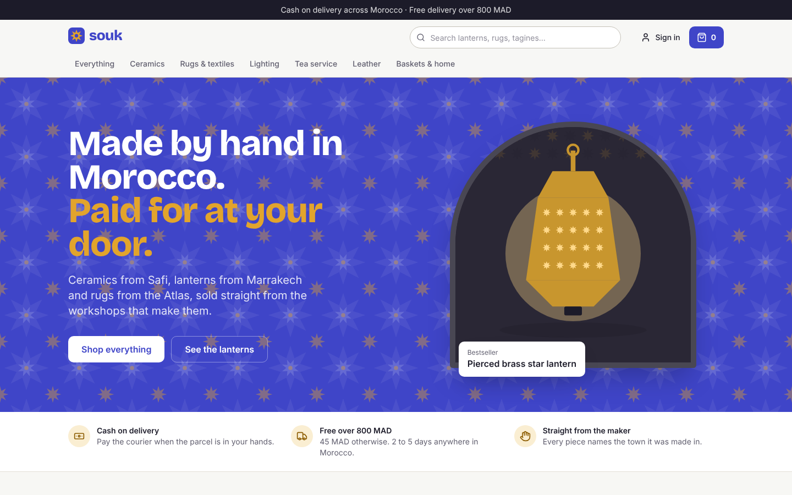
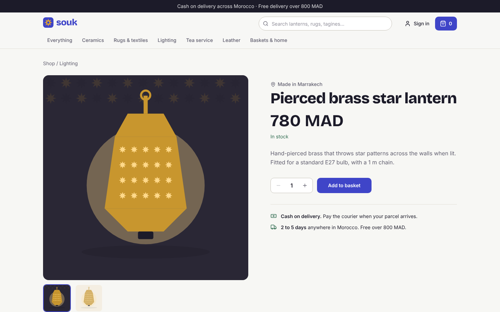
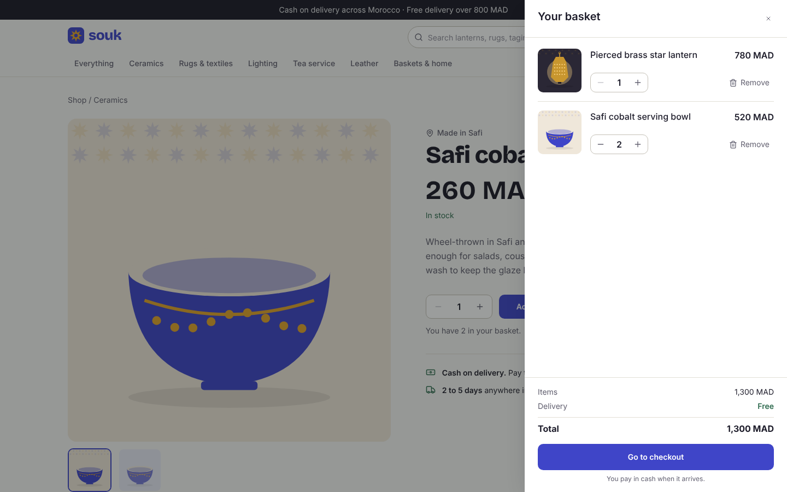
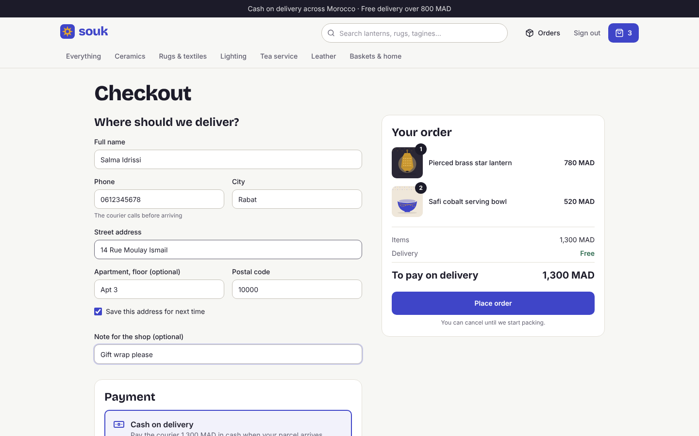
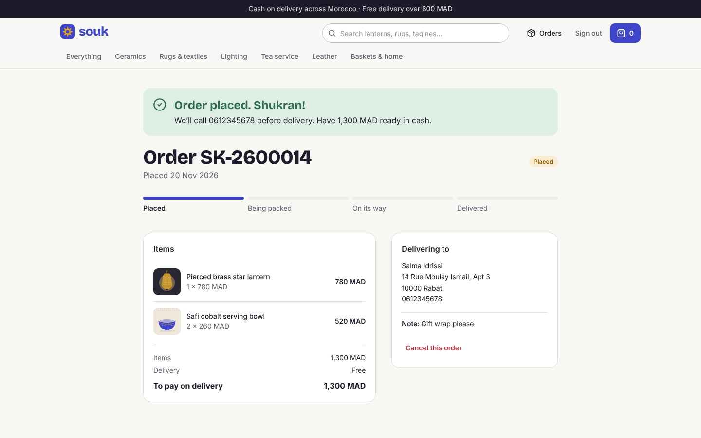
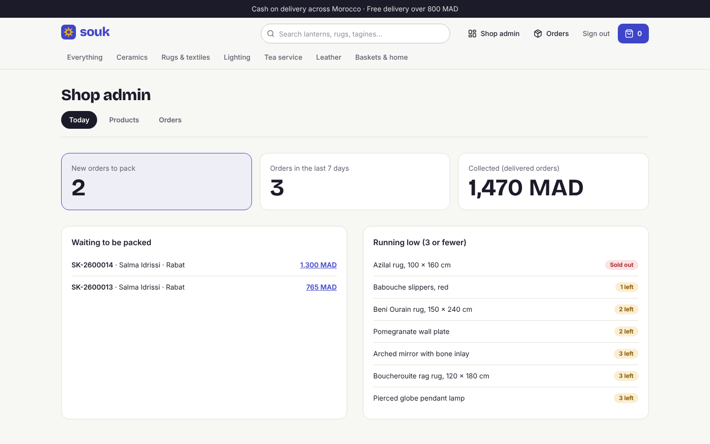
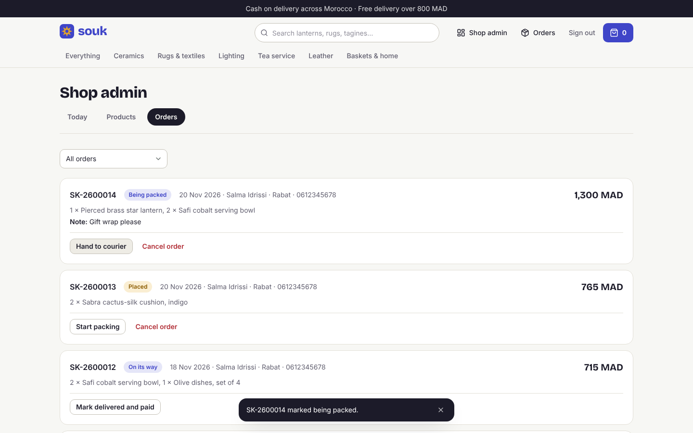

# Souk

An online shop for handmade Moroccan crafts (ceramics, rugs, lanterns, tea sets, leather and baskets) with **cash on delivery**, the way most people in Morocco pay online. It includes a storefront for customers and an admin area for products and orders.

Built for the **Auspify Technologies Full Stack Development Internship, Task 4 (E-Commerce Website)**.



**Live demo:** _add your Vercel link here_
**Customer:** `customer@souk.dev` / `Souk!2026` · **Shop admin:** `admin@souk.dev` / `Souk!2026`

## Features

**Storefront**
- Home page with categories and featured pieces.
- Catalog with category, price range, in-stock filter, sorting, search and pagination. Every filter lives in the URL.
- Product pages with a gallery, live stock ("Only 2 left", "Sold out") and related items.
- **Basket without an account.** A guest basket is stored in the browser and priced by the server. When you sign in, it **merges into your account basket**.
- Basket drawer with quantity controls and a free-delivery progress bar. If stock drops after you add an item, you're warned.

**Checkout and orders**
- Delivery address with Moroccan phone and postal-code validation. The address can be saved for next time.
- **Stock-safe checkout.** One database transaction locks the products, checks live stock, snapshots names and prices, takes the stock and empties the basket. If two people buy the last lantern at the same moment, exactly one succeeds.
- Order history, an order page with a delivery progress tracker, and cancellation until packing starts (stock is restored).

**Shop admin**
- "Today" view: orders waiting to be packed, orders this week, cash collected, and items running low.
- Product management: create, edit, hide and delete. A product that has been ordered is hidden instead of deleted, so order history stays intact.
- Orders move through Placed → Being packed → On its way → Delivered. Only valid next steps are allowed, and cancelling restores stock.

| | |
| --- | --- |
|  |  |
|  |  |
|  |  |

## Stack

| Layer | Choice |
| --- | --- |
| Frontend | React 19, Vite, TypeScript, Tailwind CSS, TanStack Query, React Hook Form, Radix UI |
| Backend | Node.js 20, Express 5, TypeScript |
| Database | PostgreSQL with Drizzle ORM: row locks (`SELECT … FOR UPDATE`) and transactions for checkout |
| Auth | argon2, JWT in an httpOnly cookie, role (CUSTOMER / ADMIN) re-read from the database on every request |
| Validation | Zod schemas shared by client and server |
| Tests | Vitest + Supertest (13 API tests: oversell race, price tampering, roles, stock restore), GitHub Actions CI |

## Product images

The 31 product images are **original flat illustrations generated from code** (`server/scripts/draw_products.py`), not stock photos, so there are no licensing issues. To use real photos, edit a product in the admin and paste image links.

## Run it locally

```bash
npm install
cp server/.env.example server/.env    # set DATABASE_URL and JWT_SECRET
npm run db:migrate
npm run db:seed                        # 31 products, 2 accounts, 4 sample orders
npm run dev                            # API :4000, shop http://localhost:5173
```

## API

| Method | Route | Who |
| --- | --- | --- |
| GET | `/api/categories`, `/api/products?q=&category=&min=&max=&sort=&inStock=&page=`, `/api/products/:slug` | Anyone |
| POST | `/api/cart/preview` | Anyone (prices a guest basket) |
| GET / PUT / POST | `/api/cart`, `/api/cart/items/:productId`, `/api/cart/merge` | Signed in |
| POST | `/api/checkout` | Signed in |
| GET / POST | `/api/orders`, `/api/orders/:id`, `/api/orders/:id/cancel` | The order's owner |
| GET | `/api/admin/stats` | Admin |
| GET / POST / PATCH / DELETE | `/api/admin/products[/:id]` | Admin |
| GET / PATCH | `/api/admin/orders[/:id]` | Admin |

## Deploy

1. Neon Postgres. 2. API on Render (`render.yaml`; migrations run on start). 3. Shop on Vercel with root `client` and `VITE_API_URL` set to the Render URL.

---

Built by M'hammed Mazin · [github.com/Mazine01](https://github.com/Mazine01) · #Auspify #AuspifyInternship
